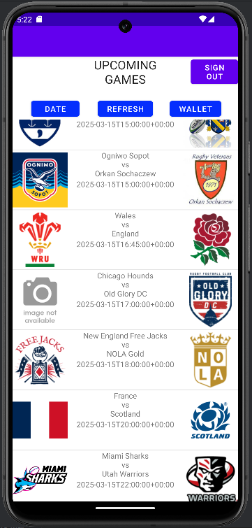
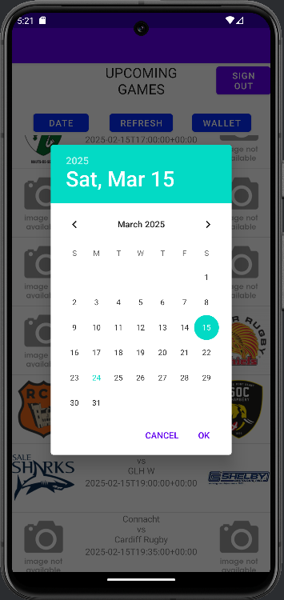
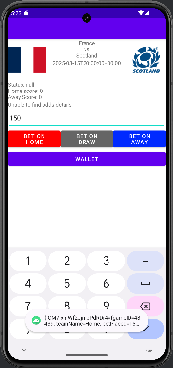
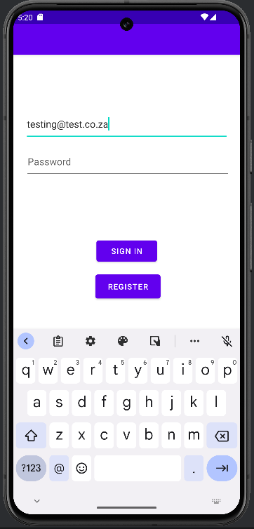

# Ruggers

An Android app for following rugby matches and making match predictions with virtual coins. Pick a date to see that day's fixtures and results, open a match to see the bookmaker odds, and back the home team, the away team or a draw. Your wallet settles each prediction automatically once the real result comes in.

<p>
  
  
  
  
</p>

## Features

- **Accounts:** sign up and log in with email and password (Firebase Authentication).
- **Fixtures by date:** a date picker loads every game on that day, with team logos, status and scores, from the API-Sports rugby API.
- **Live odds:** each match screen pulls home, away and draw odds for that game.
- **Virtual-coin predictions:** predictions are saved per user in Firebase Realtime Database.
- **Automatic settlement:** the wallet checks finished games against the API, marks each prediction won or lost, and pays out at the odds taken.

## Built with

| | |
|---|---|
| Language | Java |
| Platform | Android (min SDK 24, target SDK 34) |
| Back end | Firebase Authentication, Firebase Realtime Database |
| Data | [API-Sports Rugby](https://rapidapi.com/api-sports/api/api-rugby) via RapidAPI |
| Networking | OkHttp, Gson, Picasso for logos |

## Running it

1. Clone the repo and open it in Android Studio.
2. Get a free API key from [API-Sports Rugby on RapidAPI](https://rapidapi.com/api-sports/api/api-rugby).
3. Add it to `local.properties` in the project root (this file is never committed):
   ```
   RAPIDAPI_KEY=your_key_here
   ```
4. Run the app on an emulator or a device.

The repo includes the Firebase config for the original project. To use your own Firebase project, replace `app/google-services.json` with yours and enable Email/Password sign-in and Realtime Database.

## Project layout

| Package | What it does |
|---|---|
| `login` | Registration and login screens |
| `front_page` | Date picker and the fixtures list |
| `game_page` | Match details, odds and placing a prediction |
| `wallet` | Balance, prediction history and settling results |
